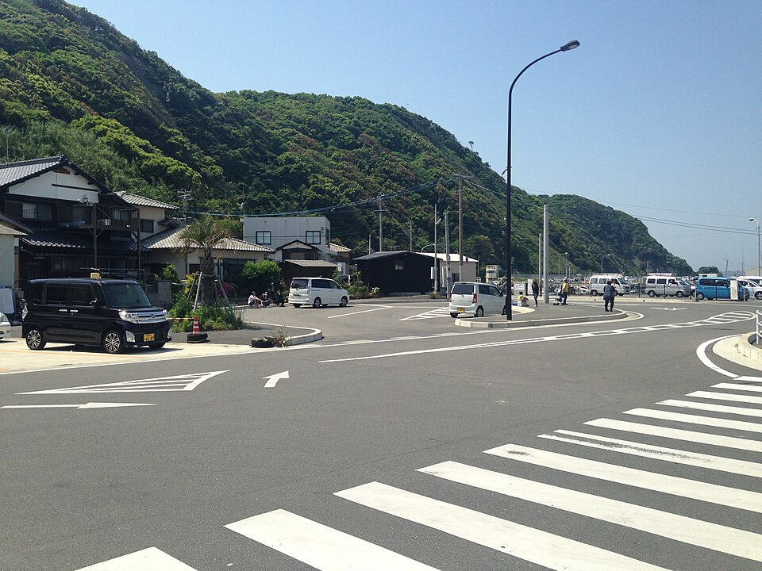

# Japanese Mountain Roads
Japan's mountain roads have played an important role in the country's transportation history because of its extensive mountain ranges and valleys. For centuries, mountain passes connected communities and provided routes for travelers, merchants, and regional trade. These roads were especially important in areas where the surrounding terrain made transportation difficult. As Japan modernized and automobile ownership increased, many mountain routes became accessible to motor vehicles. Their winding layouts, elevation changes, and surrounding landscapes eventually attracted automotive enthusiasts and tourists. Today, several Japanese mountain roads are recognized not only for their historical importance but also for their connection to touge driving culture and the country's automotive heritage.

*Fukuoka Prefectural Road No. 300 near the Kusazaki Peninsula.*

## Introduction

## Japan's Mountainous Geography
Japan's geography has strongly influenced the development of its transportation networks. Much of the country consists of mountainous terrain, with mountain ranges separating coastal plains, valleys, and populated regions. This geography historically made travel between communities difficult and increased the importance of roads that crossed mountain passes. Mountain routes were used to transport goods, connect settlements, and support regional commerce. As transportation infrastructure improved, older routes were supplemented by modern roads, tunnels, and bridges. These developments made mountainous areas more accessible to automobiles and tourism. The country's varied elevations and winding road layouts also helped make mountain driving an important part of Japanese automotive culture. Understanding Japan's geography provides useful context for understanding why touge became associated with mountain roads and vehicle performance.

## Historical Mountain Passes
Mountain passes have served as important transportation routes throughout Japanese history. Before modern highways and railways, travelers depended on established roads to cross mountainous regions and reach neighboring towns and cities. During the Edo period (1603–1868), the Tokugawa government maintained a network of major highways that supported travel, trade, and communication. One of the most important routes was the Tokaido, which connected Edo, present-day Tokyo, with Kyoto. The route included the difficult crossing through the Hakone region, where steep terrain made travel challenging. These historical transportation routes demonstrate how important mountain crossings were to Japanese society long before automobiles became common. Their development also established transportation corridors that would later influence modern road networks.

### The Hakone Region
The Hakone region has played an important role in Japanese transportation history because of its mountainous landscape and strategic location between eastern and western Japan. During the Edo period, Hakone was a major checkpoint along the Tokaido highway, one of the principal routes connecting Edo and Kyoto. Travelers faced steep slopes and difficult terrain when crossing the mountains, making this section of the journey particularly challenging. The historic Hakone checkpoint also served as an important security and inspection point under the Tokugawa shogunate. Over time, transportation infrastructure in the region improved, allowing modern roads and vehicles to travel through the mountains. Today, Hakone is recognized for its historical sites, mountain scenery, and winding roads, which have also made it a popular destination for automotive enthusiasts and tourists.

### The Old Tokaido Highway
The Old Tokaido Highway was one of the most important transportation routes in Japan during the Edo period. It connected Edo, which is now Tokyo, with Kyoto and passed through several important towns and regions. The route supported travel, commerce, and communication between different parts of the country. Travelers included merchants, government officials, and people making journeys for political or personal reasons. The highway was divided into officially recognized stations where travelers could rest, obtain supplies, and change horses. One of its most challenging sections crossed the mountainous Hakone region. Although modern highways and railways have replaced much of the original transportation system, sections of the historic Tokaido remain preserved today. The highway represents an important part of Japanese transportation history and demonstrates how mountain routes helped connect the country long before modern automobiles existed.

## Famous Roads and Their Automotive History

### Mount Haruna
Mount Haruna is a volcanic mountain located in Gunma Prefecture, Japan. It is surrounded by a landscape of winding roads, forests, and elevated terrain that has made the area well known among Japanese automotive enthusiasts. The mountain is particularly recognizable because of its connection to the fictional Mount Akina in the manga and anime series Initial D. The series used locations inspired by real roads around Mount Haruna to portray mountain-pass driving competitions. This connection helped introduce the region to international fans of Japanese automotive culture. Mount Haruna also represents the relationship between Japanese geography, local communities, and automotive tourism. Although its popularity in popular media is significant, the mountain has its own geographical and cultural importance independent of its fictional representation.

### Irohazaka
Irohazaka is a famous series of winding mountain roads located in Nikko, Tochigi Prefecture, Japan. The route connects the lower areas of Nikko with the higher elevations near Lake Chuzenji and is known for its numerous sharp curves and changes in elevation. Historically, the road provided access to important religious and scenic destinations in the surrounding mountains. As automobile tourism developed, Irohazaka became a popular route for visitors interested in experiencing Japan's mountainous landscapes. Its distinctive design includes separate uphill and downhill roads, helping manage traffic along the steep route. Irohazaka has also gained recognition among automotive enthusiasts because of its challenging layout and appearances in Japanese automotive media. The road demonstrates how historical transportation routes and modern infrastructure can become part of Japan's wider automotive identity.

## Mountain Roads and Touge Culture
Japanese mountain roads eventually became closely associated with the country's growing automotive enthusiast communities. Their winding layouts, elevation changes, and challenging terrain attracted drivers interested in vehicle handling and performance. During the late twentieth century, mountain-pass driving became an identifiable part of grassroots Japanese car culture. Automotive magazines, racing videos, and popular media helped spread awareness of these roads and the vehicles associated with them. Locations such as Hakone and the mountain roads of Gunma became recognizable among automotive enthusiasts. The popularity of Initial D further introduced fictional versions of these locations to international audiences. However, mountain roads remain public transportation routes, not private racing circuits. Their historical significance and cultural influence should be understood separately from illegal street racing, which creates serious safety risks.

## Related Categories
Japanese mountain roads helped shape the history of [[origins-and-history|Touge Racing]] and its development as an automotive subculture.

The geography of these roads also influenced the development of [[touge-driving-techniques|Touge Driving Techniques]].